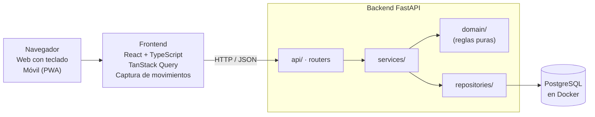

# Planeación: Digital Budget

Última actualización: 2026-11-09

> **Para Claude (u otra sesión que retome el proyecto):** este archivo es la fuente de verdad de la planeación. Antes de proponer cambios, lee el "Registro de decisiones" y respeta lo ya resuelto. Si el usuario toma una decisión nueva, agrégala al registro con su fecha y actualiza la sección afectada. El usuario trabaja solo, quiere experiencia full stack para su CV y prefiere conversar en español.

## Registro de decisiones

| Fecha | Decisión |
| --- | --- |
| 2026-11-04 | Stack: FastAPI + PostgreSQL + React/TypeScript. Todo local con Docker, preparado para deploy. |
| 2026-11-04 | Demo el 13 nov, v1 el 4 dic. Supuesto: ~6 h/día, 6 días/semana. |
| 2026-11-04 | La captura empieza convencional (fase 1). La barra de comandos y los gestos táctiles se detallan después de la v1 (fase 2). |
| 2026-11-04 | Se agrega el modo ahorro: monto real y contable, apartados, sobrante. |
| 2026-11-05 | Compras con tarjeta en modo ahorro: el real baja el crédito disponible de la tarjeta; el contable baja el disponible igual que con débito. Las cuentas de débito no cambian hasta pagar. |
| 2026-11-05 | La cuenta de ahorro "Sobrante" se crea por defecto y recibe las diferencias de redondeo. |
| 2026-11-05 | Cuentas de ahorro con meta: se deposita desde el disponible; al completar la meta aparece "Retirar ahorro", que cierra la cuenta y pasa el total al disponible. |
| 2026-11-05 | Nombre del proyecto: **Digital Budget**. Repositorio `digital-budget`. |
| 2026-11-05 | Advertencias en compras con tarjeta: nivel 1 si supera el disponible, nivel 2 si supera el saldo real. |
| 2026-11-05 | Frontend con React 19 (no 18), Tailwind v4, TypeScript 7 y Node 26 LTS. Se mantiene ESLint en lugar de oxlint, que trae la plantilla de Vite. |
| 2026-11-05 | TypeScript 6.0 en lugar de 7: typescript-eslint aún no soporta TS 7 (compilador en Go). Subir a TS 7 cuando lo soporte. |
| 2026-11-05 | Montos con signo en la BD: negativo cuando el dinero sale de la cuenta, positivo cuando entra. La API recibe montos positivos y el tipo decide el signo. En crédito, saldo negativo = deuda. |
| 2026-11-05 | IDs UUID en todas las tablas (facilita la actualización optimista: el frontend puede generar el ID). |
| 2026-11-05 | SQLAlchemy síncrono (no async): más simple; FastAPI corre los endpoints síncronos en un threadpool. |
| 2026-11-05 | Un usuario local sembrado por la migración inicial (`00000000-…-0001`) hasta tener registro y login. Las categorías precargadas se copian por usuario. |
| 2026-11-05 | Se adelanta al día 5 una API mínima: `GET/POST /accounts`, `GET /categories`, `GET/POST /movements` y `POST /transfers`. |
| 2026-11-05 | Una compra hecha el día de corte entra en ese mismo ciclo (el que cierra ese día), no en el siguiente. Confirmado con dos estados de cuenta reales de bancos distintos. El ciclo es inclusivo en el día de corte (regla 4) y no hace falta un campo de configuración para esto. |
| 2026-11-06 | La fecha límite de pago cambia según el banco, así que cada tarjeta elige una de dos formas: un día fijo del mes (por ejemplo, el 5) o un número de días después del corte (por ejemplo, 20). Se guarda como regla + valor en la configuración de crédito. |
| 2026-11-06 | La configuración de crédito (límite, día de corte y regla de pago) es obligatoria al crear una cuenta de crédito y se rechaza en las demás. No se permiten tarjetas sin configurar para completarlas después: así no hay cálculos de ciclo erróneos. Se guarda en la tabla `credit_configs`, uno a uno con la cuenta. |
| 2026-11-06 | MSI y disponible: el crédito disponible de la tarjeta baja por el total el día de la compra, pero el disponible del usuario baja mensualidad por mensualidad, al inicio de cada ciclo, con su monto contable (el redondeo va a Sobrante). El gasto de la compra guarda real = −total y contable = 0 (excepción a "contable = real en modo simple"); el contable vive en cada mensualidad, que no es un movimiento. |
| 2026-11-06 | Séptima cifra del modo ahorro: **MSI por cargar** (mensualidades aún no descontadas del disponible). Invariante: saldo real = disponible + apartado + deuda de tarjetas + ahorros con meta + sobrante − MSI por cargar. |
| 2026-11-06 | Cifras principales en pantalla: saldo real, disponible, deuda de tarjetas y MSI por cargar. Apartado, ahorros con meta y sobrante se muestran como detalle secundario. |
| 2026-11-06 | La primera mensualidad MSI cae en el ciclo de la compra y se carga al disponible ese mismo día; las demás, el día siguiente al corte anterior. Sin procesos programados: cada mensualidad guarda su fecha de cargo. |
| 2026-11-06 | Plazos MSI de 3 a 48 meses. En el frontend se muestran primero 3, 6, 9 y 12. |
| 2026-11-09 | Se aprueba la propuesta del día 9. Al editar un movimiento no se cambian la cuenta ni el tipo (se borra y se captura de nuevo); en transferencias y pagos de tarjeta se editan las dos partes juntas (monto, fecha, descripción). |
| 2026-11-09 | Si al editar un gasto o ingreso solo se manda el monto, el contable vuelve a ser igual al real (como al crear); si solo se manda el contable, se conserva el real. Conservar el contable anterior podría dejarlo por debajo del real en un gasto. |
| 2026-11-09 | Las compras a MSI no se editan hasta la v1 (adelantar o liquidar): `PATCH` responde 409. Campos desconocidos en `PATCH /movements/{id}` (por ejemplo `account_id` o `type`) responden 422 en lugar de ignorarse. |
| 2026-11-09 | Borrado lógico: `DELETE /movements/{id}` responde 204 y un movimiento borrado da 404 en el resto de la API (también un segundo `DELETE`). `POST /movements/{id}/restore` lo deshace sin límite de tiempo (el aviso de deshacer vive en el frontend) y responde 409 si el movimiento no está borrado. Las dos partes de una transferencia se borran y restauran juntas. |
| 2026-11-09 | Borrar una compra a MSI solo marca su movimiento: el plan y sus mensualidades se conservan, y las consultas los excluyen mientras la compra esté borrada. Toda consulta nueva sobre mensualidades (por ejemplo, MSI por cargar en `/summary`) debe filtrar compras borradas. |
| 2026-11-09 | Próximo pago de una tarjeta: el estado de cuenta cerrado más antiguo cuya fecha límite no ha pasado (el día límite cuenta). Si todos vencieron, el ciclo abierto con lo cargado hasta hoy, marcado `is_closed: false`. Con corte el 15 y pago el 5: del 16 nov al 5 dic, el corte del 15 nov; del 6 al 15 dic, el ciclo que cierra el 15 dic. Un pago vencido no se arrastra (límite de la regla 8, se revisa en la v1). |
| 2026-11-09 | `GET /summary` v1: saldo real (débito y efectivo; las cuentas de ahorro no cuentan), deuda de tarjetas (una tarjeta con saldo a favor resta), MSI por cargar (mensualidades con fecha de cargo posterior a hoy, sin compras borradas) y próximo pago de cada tarjeta. No acepta `?on=`: los saldos no se filtran por fecha, y mezclar días daría cifras incoherentes. |
| 2026-11-09 | `PATCH /accounts/{id}` edita nombre (409 si ya existe), color (`null` lo quita), saldo inicial (para corregir errores de captura) y, en tarjetas, la configuración de crédito: los campos enviados se combinan con los actuales y se validan juntos. El tipo, la posición y archivar no se editan (422; reordenar y archivar son de la v1). |
| 2026-11-09 | Cambiar el día de corte de una tarjeta recalcula la fecha de corte y de cargo de todas sus mensualidades MSI, incluidas las de compras borradas; los montos no cambian. Pensado para corregir errores: si un banco cambiara de verdad el día de corte, también se reescribirían los cortes pasados (se revisa en la v1). |
| 2026-11-09 | En los servicios que editan, primero se valida todo y después se aplican los cambios, para que una edición rechazada no deje nada a medias. |
| 2026-11-09 | Tipos del frontend generados con `openapi-typescript` (`npm run api:types`, con el backend levantado). `src/api/schema.d.ts` se sube al repo para compilar sin backend y ver en el diff cómo cambia el contrato. `openapi-typescript` 7 pide TS 5 como peer: un `overrides` acotado a ese paquete le da nuestro TS 6 (mejor que `--legacy-peer-deps`, que relaja todos los peers). Un chequeo en CI de que los tipos estén al día se evalúa con GitHub Actions en la v1. |
| 2026-11-09 | Llamadas con `openapi-fetch` y TanStack Query. `unwrap()` convierte las respuestas con error en `ApiError` (`status`, `detail` de FastAPI como mensaje; los 422 juntan sus `msg`). Claves de caché centralizadas en `queryKeys` para que las mutaciones del día 11 invaliden lo necesario. Por defecto: `staleTime` 30 s y un reintento. Sin MSW por ahora: las pruebas simulan `fetch`. |
| 2026-11-09 | `formatMoney` formatea el string de la API con `Intl.NumberFormat('es-MX', MXN)`, que trata los strings como decimales exactos (ES2023), sin pasar por `float`. Rechaza lo que no tenga forma de monto en lugar de mostrar `NaN` y muestra el cero negativo sin signo. |
| 2026-11-09 | Primera pantalla: resumen (saldo real, deuda de tarjetas, MSI por cargar; disponible se agrega el día 10, sin hueco vacío mientras tanto), una tarjeta por cuenta y los últimos 50 movimientos por día. Una columna en móvil y dos desde `lg`. Solo lectura: crear, editar y borrar llegan con la captura del día 11. |
| 2026-11-09 | En la pantalla, cada sección maneja su propio estado de carga, error (con "Reintentar") y vacío, para que una llamada que falla no deje la página en blanco. El frontend no hace cuentas con dinero: la deuda y el próximo pago de cada tarjeta vienen de `/summary`. Una transferencia o pago de tarjeta se muestra como una sola fila. |
| 2026-11-09 | Las fechas de la API (`AAAA-MM-DD`) nunca pasan por `new Date(iso)`, que las lee como medianoche UTC y en México las muestra un día antes. `lib/dates.ts` las separa y formatea en UTC con `Intl` (es-MX: "vie 20 de nov", "5 dic"). |

## Resumen

Una webapp de finanzas personales que entiende cómo funcionan las tarjetas en México (corte, fecha límite de pago y meses sin intereses) y que, en modo ahorro, distingue tu saldo real de tu dinero disponible. Demo funcional el 13 de noviembre; v1 lista para usuarios externos el 4 de diciembre.

**Objetivos**

- Registrar un movimiento rápido y sin fricción; primero con captura convencional, después con barra de comandos y gestos.
- Saber en todo momento cuánto debo pagar de cada tarjeta y antes de qué fecha.
- Construir un proyecto de portafolio full stack, con pruebas, CI y listo para deploy.

**Supuestos de trabajo**

- Dedicación de ~6 horas al día, 6 días a la semana (unas 36 h/semana).
- Un solo desarrollador, presupuesto cero, todo corre en local con Docker.
- Moneda única: MXN. Sin conexión a bancos; los datos se capturan a mano.

**Alcance**

| | Demo (13 nov) | v1 (4 dic) |
| --- | --- | --- |
| Cuentas | Débito, efectivo, crédito y la cuenta Sobrante | + cuentas de ahorro con meta, archivar, reordenar, colores |
| Movimientos | Gasto, ingreso, transferencia, pago de tarjeta | + editar en lote, búsqueda, etiquetas |
| Tarjetas de crédito | Corte, fecha de pago, saldo del ciclo | + pago para no generar intereses, alertas en la app |
| MSI | Alta de compra y mensualidades por ciclo | + adelantar mensualidades, liquidar |
| Modo ahorro | Monto real y contable, apartados, sobrante, advertencias de compra | + redondeo automático, apartados recurrentes |
| Captura | Formulario convencional rápido, web y móvil | Igual, pulido; barra de comandos y gestos pasan a la fase 2 |
| Usuarios | Un usuario local | Registro, login y datos aislados por usuario |
| Calidad | Pruebas del dominio | + pruebas de API y E2E, CI en GitHub |

**Fuera de alcance por ahora:** sincronización bancaria, varias monedas, presupuestos por categoría, cobro de donaciones (solo un enlace), app nativa.

## Stack recomendado

FastAPI en el backend y React con TypeScript en el frontend: es la combinación con más vacantes para perfiles junior/mid full stack y deja ver tipado de punta a punta.

| Capa | Elección | Por qué suma al CV |
| --- | --- | --- |
| Backend | Python 3.12 + FastAPI + Pydantic v2 | API moderna, async, documentación OpenAPI automática |
| ORM y migraciones | SQLAlchemy 2.0 + Alembic | El estándar en Python; las migraciones se piden en casi cualquier puesto |
| Base de datos | PostgreSQL 16 | La base relacional más pedida; transacciones y `NUMERIC` para dinero |
| Frontend | React 19 + TypeScript + Vite | El framework con más demanda; TypeScript ya es requisito común |
| Estado del servidor | TanStack Query | Caché, reintentos y actualizaciones optimistas para que la captura se sienta instantánea |
| Estilos | Tailwind CSS | Rápido para iterar en web y móvil con un solo código |
| Cliente de API | Tipos generados desde OpenAPI (`openapi-typescript`) | Contrato tipado entre backend y frontend |
| PWA | `vite-plugin-pwa` | Instalable en el celular sin tienda de apps |
| Pruebas | pytest + httpx, Vitest, Playwright | Pruebas unitarias, de API y E2E: muy valorado en entrevistas |
| Infraestructura | Docker Compose, GitHub Actions | Todo local hoy; el mismo contenedor sirve para el deploy |
| Calidad | Ruff, mypy, ESLint, Prettier, pre-commit | Señal de profesionalismo en el repo |

**Alternativa considerada:** Next.js o NestJS con TypeScript en todo el stack. Tiene buena demanda, pero cambiarías Python por Node; con FastAPI ya muestras dos lenguajes, lo cual suele pesar más en un CV.

## Modelo de dominio y reglas de negocio

El corazón del proyecto es la tarjeta de crédito: un ciclo de corte, una fecha límite y compras a MSI que se reparten entre ciclos. Todo lo demás es un movimiento entre cuentas.

**Entidades**

| Entidad | Campos clave | Notas |
| --- | --- | --- |
| Cuenta | tipo (débito, efectivo, crédito, ahorro), nombre, saldo inicial, color | Una tabla con campos opcionales para crédito; ahorro: "Sobrante" por defecto y cuentas con meta (monto objetivo, estado) |
| Config. de crédito | límite, día de corte, regla de pago (día fijo o días después del corte) y su valor | Uno a uno con la cuenta de crédito |
| Movimiento | cuenta, tipo, monto real, monto contable, fecha, descripción, categoría, apartado | Tipos: gasto, ingreso, transferencia, pago de tarjeta. Monto contable = real en modo simple |
| Transferencia | grupo que une dos movimientos | Sale de una cuenta y entra a otra en una sola transacción de BD |
| Apartado | nombre, monto, fecha esperada, recurrencia, estado | Gasto contemplado del modo ahorro; se consume al pagarlo |
| Plan MSI | cuenta, monto total, meses, fecha de compra | Genera una mensualidad por ciclo |
| Mensualidad MSI | plan, número, monto, monto contable, fecha de corte, fecha de cargo al disponible | Se calcula al crear el plan; no es un movimiento |
| Categoría | nombre, ícono | Precargadas; el usuario puede agregar |
| Preferencias | modo (simple o ahorro), múltiplo de redondeo | Una por usuario |

**Reglas**

1. El dinero se guarda como `NUMERIC(12,2)` en Postgres y `Decimal` en Python; nunca `float`.
2. Saldo de débito/efectivo = saldo inicial + ingresos − gastos ± transferencias.
3. Deuda de crédito = cargos − pagos, incluido el total de las compras a MSI. Crédito disponible = límite − deuda.
4. El ciclo de una tarjeta va del día siguiente al corte anterior hasta el día de corte, inclusive: una compra hecha el día de corte entra en el ciclo que cierra ese día. Ejemplo con corte el 15: el ciclo va del 16 del mes anterior al 15; una compra del 15 de noviembre entra en el corte del 15 de noviembre y una del 16, en el del 15 de diciembre. (Confirmado con dos estados de cuenta reales.)
5. Si el día de corte o de pago no existe en el mes (por ejemplo 31 en noviembre), se usa el último día del mes.
6. Una compra a MSI ocupa el crédito completo de inmediato (se registra como un gasto por el total), pero solo su mensualidad entra en el pago de cada ciclo. La primera mensualidad cae en el ciclo de la compra. Plazos de 3 a 48 meses.
7. Mensualidad = total ÷ meses, redondeada a centavos; la última absorbe la diferencia para que la suma cuadre exacta.
8. Pago para no generar intereses = cargos normales del ciclo cerrado + mensualidades MSI de ese ciclo − pagos hechos después del corte.
9. Un pago de tarjeta es una transferencia de una cuenta de débito (o efectivo) a la cuenta de crédito.
10. Los movimientos nunca se borran físicamente: se marcan como eliminados para poder deshacer.

**Confirmado con tus tarjetas reales (2026-11-05):** una compra hecha el día de corte entra en ese mismo ciclo, según dos estados de cuenta de bancos distintos.

**Límites conocidos del estado de cuenta (2026-11-06):** la regla 8 no arrastra saldo de ciclos que no pagaste completos, y el saldo inicial de una tarjeta no cae en ningún ciclo. Para el demo basta; se revisa en la v1.

**Fecha límite de pago (2026-11-06):** depende del banco, así que cada tarjeta elige una de dos reglas:

- Día fijo: la primera fecha con ese día del mes posterior al corte (con la regla 5 si el día no existe). Con corte el 15 y pago el 5, el corte del 15 de noviembre se paga el 5 de diciembre.
- Días después del corte: la fecha de corte más N días naturales. Con corte el 15 y 20 días, el corte del 15 de noviembre se paga el 5 de diciembre.

## Modo ahorro

Un modo opcional que separa el dinero que tienes del dinero que de verdad puedes gastar. Con $5,000 en el banco y la luz de $500 ya contemplada, tu disponible es $4,500.

**Siete cifras**

| Cifra | Qué es | En el ejemplo |
| --- | --- | --- |
| Saldo real | Lo que hay en tus cuentas de débito y efectivo | $5,000.00 |
| Apartado | Gastos contemplados que aún no pagas | $500.00 |
| Deuda de tarjetas | Lo que debes en tus tarjetas de crédito | $0.00 |
| Disponible | Lo que puedes gastar sin tocar lo apartado, lo ahorrado ni lo que debes | $4,500.00 |
| Sobrante | Saldo a favor que generan tus redondeos, en la cuenta "Sobrante" | $0.00 |
| Ahorros con meta | Lo depositado en tus cuentas de ahorro con objetivo | $0.00 |
| MSI por cargar | Mensualidades MSI que aún no se descuentan de tu disponible (ya están dentro de la deuda) | $0.00 |

En pantalla, las cuatro principales son saldo real, disponible, deuda de tarjetas y MSI por cargar; apartado, ahorros con meta y sobrante van como detalle.

Las siete siempre cuadran (invariante que se prueba en cada operación):

```
Saldo real = Disponible + Apartado + Deuda de tarjetas + Ahorros con meta + Sobrante − MSI por cargar
```

El invariante no suma deudas a tu dinero: reparte tu saldo real en partes. Despejado: Disponible = Saldo real − Apartado − (Deuda − MSI por cargar) − Ahorros − Sobrante. Tu dinero neto sería Saldo real − Deuda de tarjetas.

**Monto real y monto contable**

Cada movimiento guarda dos montos: el real, que es lo que se movió en el banco o la tarjeta, y el contable, que es lo que afecta tu disponible. La diferencia se acumula en el sobrante. En modo simple ambos son iguales.

| Paso | Real (MXN) | Contable (MXN) | Saldo real | Deuda | Disponible | Sobrante |
| --- | --- | --- | --- | --- | --- | --- |
| Inicio, luz apartada ($500) | — | — | 5,000.00 | 0.00 | 4,500.00 | 0.00 |
| Cine con débito | −387.56 | −400.00 | 4,612.44 | 0.00 | 4,100.00 | 12.44 |
| Despensa con tarjeta | −634.00 | −640.00 | 4,612.44 | 634.00 | 3,460.00 | 18.44 |
| Quincena | +10,164.67 | +10,000.00 | 14,777.11 | 634.00 | 13,460.00 | 183.11 |
| Pago de luz (costó 487.00) | −487.00 | −500.00 del apartado | 14,290.11 | 634.00 | 13,460.00 | 196.11 |
| Pago de tarjeta | −634.00 | — | 13,656.11 | 0.00 | 13,460.00 | 196.11 |

**Reglas**

1. En gastos el monto contable es mayor o igual al real; en ingresos, menor o igual. La app avisa si capturas lo contrario.
2. Al capturar, la app propone el monto contable redondeando al múltiplo que elijas (10 por defecto); lo puedes cambiar a mano.
3. Un apartado tiene nombre, monto y fecha esperada, y puede repetirse (luz cada dos meses). Pagarlo consume el apartado, no el disponible; la diferencia va al sobrante.
4. Una compra con tarjeta de crédito funciona igual que con débito para el disponible: baja por el monto contable. El monto real baja el crédito disponible de la tarjeta y sube su deuda; las cuentas de débito no cambian hasta que pagas.
5. Las compras a MSI no bajan el disponible por el total: cada mensualidad lo baja por su monto contable al inicio de su ciclo (la primera, el día de la compra) y la diferencia del redondeo va al sobrante. El total sí sube la deuda y baja el crédito disponible de la tarjeta desde el día de la compra. Mientras tanto, lo pendiente se ve en "MSI por cargar".
6. Pagar la tarjeta es una transferencia de débito a crédito: bajan el saldo real y la deuda por igual; el disponible y el sobrante no cambian.
7. La cuenta de ahorro "Sobrante" se crea de forma predeterminada y no se puede borrar. Ahí se acumula la diferencia entre montos reales y contables, y no cuenta en el disponible.
8. El modo se activa por usuario. Los datos guardan ambos montos desde el día 1, así que cambiar de modo no pierde información.

**Advertencias en compras con tarjeta de crédito**

El modo ahorro existe para no gastar dinero que no tienes. Por eso, al capturar una compra con tarjeta, la app compara antes de guardar y avisa, sin bloquear:

| Nivel | Cuándo | Qué ve el usuario |
| --- | --- | --- |
| 1 · Aviso | El monto contable supera el disponible | Mensaje en amarillo: "Esta compra supera tu disponible por $X" |
| 2 · Alerta | El monto real supera el saldo real de todas tus cuentas de débito y efectivo | Mensaje en rojo, más visible, y confirmar con un clic extra antes de guardar |

Si se cumplen ambas, solo se muestra el nivel 2. Aplica a cualquier compra con tarjeta, cerca o lejos de la quincena, incluidas las MSI.

**Por definir (día 10):** en MSI, propuesta de nivel 1 si el contable de la primera mensualidad supera el disponible, y nivel 2 si el total real supera el saldo real.

**Cuentas de ahorro con meta**

Además de Sobrante, puedes crear cuentas de ahorro con un objetivo. Funcionan como un apartado que se llena con depósitos desde tu disponible.

| Paso | Disponible | Ahorro "Consola" | Falta | Saldo real |
| --- | --- | --- | --- | --- |
| Crear meta de $10,000 | 13,460.00 | 0.00 | 10,000.00 | 13,656.11 |
| Depositar $1,000 | 12,460.00 | 1,000.00 | 9,000.00 | 13,656.11 |
| Completar con depósitos | 3,460.00 | 10,000.00 | 0.00 | 13,656.11 |
| Retirar ahorro | 13,460.00 | cerrada | — | 13,656.11 |

1. Una meta tiene nombre, monto objetivo y lo ahorrado; la app muestra cuánto falta y el avance.
2. Depositar baja el disponible y sube la meta. El saldo real no cambia: el dinero sigue en tus cuentas.
3. Al llegar al objetivo aparece "Retirar ahorro": cierra la meta y pasa el total a tu disponible para hacer la compra.
4. Puedes tener varias metas a la vez. Sobrante no tiene meta y solo recibe las diferencias de redondeo.

**Por definir:** si se permite retirar una meta antes de completarla y si se puede depositar más del objetivo.

## Diseño de interacción

La captura llega en dos fases: primero una convencional que funcione bien en web y móvil, y después de la v1 la barra de comandos y los gestos, que se diseñarán a detalle en su momento.

**Fase 1 (demo y v1) · captura convencional**

- Un botón "Nuevo" (o la tecla `N`) abre un panel con tipo (pestañas), monto, cuenta y categoría. Fecha de hoy y última cuenta usada por defecto.
- `Enter` guarda y deja el panel listo para el siguiente movimiento; `Esc` cierra.
- En móvil el panel ocupa la pantalla y el campo de monto abre el teclado numérico del sistema.
- En modo ahorro aparece un segundo campo, monto contable, ya precargado con el redondeo propuesto.
- En compras con tarjeta se muestran las advertencias de nivel 1 o 2 antes de guardar.
- Pantalla inicial con saldo real, disponible, deuda de tarjetas y MSI por cargar (apartado, ahorros y sobrante como detalle); y cuánto pagar de cada tarjeta.
- Al elegir plazo MSI se muestran primero 3, 6, 9 y 12 meses; se puede escribir cualquier plazo de 3 a 48.

**Fase 2 (después de la v1) · propuesta preliminar, se detallará más adelante**

*Web: barra de captura.* Una sola barra siempre visible arriba de la lista. Se enfoca con `/` o `N`. Mientras escribes, el texto se convierte en chips (monto, cuenta, categoría, fecha) para que veas cómo se interpretó. `Tab` autocompleta, `Enter` guarda, `Esc` limpia.

| Escribes | Se guarda como |
| --- | --- |
| `350 tacos @bbva #comida` | Gasto de $350 en BBVA, categoría Comida, hoy |
| `+15000 nómina @nu` | Ingreso de $15,000 en Nu |
| `2000 @bbva > @nu` | Transferencia de BBVA a Nu |
| `pago 5000 @bbva > @tdc-oro` | Pago de $5,000 a la tarjeta Oro desde BBVA |
| `12000 laptop @tdc-oro 12msi` | Compra a 12 MSI, mensualidades de $1,000 |
| `90 uber ayer` | Gasto de ayer en la última cuenta usada |

Otros atajos: `↑` `↓` para moverte en la lista, `E` editar, `Supr` eliminar con aviso de deshacer, `Ctrl+Z` deshacer, `1`–`9` para filtrar por cuenta y `?` para ver todos los atajos.

*Móvil: captura táctil.*

1. Un botón `+` grande abre un teclado numérico a pantalla completa: escribes el monto.
2. Debajo aparecen chips de cuenta (la última ya seleccionada) y las 6 categorías que más usas. Un toque elige.
3. Confirmas con un botón grande. Mantener presionado `+` cambia entre gasto, ingreso y transferencia.

En la lista: deslizar a la izquierda elimina (con deshacer), a la derecha duplica. Arriba, las cuentas son tarjetas que se deslizan horizontalmente.

**Principios**

- Un solo nivel de navegación: Movimientos, Cuentas, Tarjetas. Sin submenús.
- La configuración vive dentro de la cuenta que configura, no en una pantalla aparte.
- La UI se actualiza al instante (actualización optimista) y se sincroniza con la API en segundo plano.
- El intérprete de la barra (fase 2) será una función pura en TypeScript con pruebas propias; la API valida igual.

## Arquitectura

Un monorepo con dos aplicaciones y una base de datos, levantadas con `docker compose up`. Las reglas de negocio viven en una capa de dominio sin dependencias de FastAPI ni de la BD, para probarlas aisladas.



La API solo traduce HTTP; `services/` orquesta y abre transacciones; `domain/` calcula ciclos, MSI, saldos y modo ahorro sin tocar la base de datos.

**Estructura del repositorio**

```
digital-budget/
├── backend/
│   ├── app/
│   │   ├── domain/        # reglas: ciclos, MSI, saldos, modo ahorro (Python puro)
│   │   ├── models/        # SQLAlchemy
│   │   ├── schemas/       # Pydantic
│   │   ├── repositories/  # acceso a datos
│   │   ├── services/      # casos de uso, transacciones de BD
│   │   └── api/           # routers FastAPI
│   ├── alembic/
│   └── tests/
├── frontend/
│   ├── src/
│   │   ├── features/      # movements, accounts, cards
│   │   ├── capture/       # formulario de captura (barra en fase 2)
│   │   ├── api/           # cliente generado desde OpenAPI
│   │   └── ui/            # componentes compartidos
│   └── tests/
├── docker-compose.yml
├── CLAUDE.md
├── docs/PLANEACION.md
└── .github/workflows/ci.yml
```

**API principal (`/api/v1`)**

| Método y ruta | Uso |
| --- | --- |
| `GET/POST /accounts` | Listar y crear cuentas |
| `PATCH /accounts/{id}` | Editar cuenta y su configuración de crédito |
| `GET/POST /movements` | Listar con filtros y registrar gasto, ingreso o transferencia (monto real y contable); la respuesta de validación incluye advertencias de nivel 1 o 2 |
| `PATCH/DELETE /movements/{id}` | Editar o eliminar (borrado lógico) |
| `POST /installment-plans` | Crear compra a MSI y sus mensualidades |
| `GET /cards/{id}/statement?cycle=` | Resumen del ciclo: cargos, MSI, pagado, por pagar, fechas |
| `GET/POST/PATCH /commitments` | Apartados del modo ahorro |
| `GET /summary` | Las siete cifras del modo ahorro y próximos pagos |
| `POST /savings-goals`, `/{id}/deposit`, `/{id}/withdraw` | Crear metas de ahorro, depositar y retirar al completarlas |
| `GET/PATCH /preferences` | Modo simple o ahorro y múltiplo de redondeo |
| `POST /auth/register`, `/auth/login` | Usuarios (v1, semana 1) |

**Listo para deploy sin costo hoy:** configuración por variables de entorno, contenedores con imágenes de producción, migraciones automáticas al arrancar, CORS configurable y `user_id` en todas las tablas desde el día 1, aunque el demo tenga un solo usuario.

## Plan al demo (4–13 nov)

Ocho días de trabajo y un día de respiro. Primero el dominio con pruebas, luego la API, al final la interfaz: así la lógica de tarjetas queda sólida aunque la UI se recorte.

**Mié 4 · Base del proyecto**

- [x] Crear repo en GitHub con la estructura del monorepo
- [x] `docker-compose.yml` con Postgres, backend y frontend
- [x] FastAPI con `/health` y Vite + React + TS + Tailwind arrancando
- [x] Ruff, mypy, ESLint, Prettier y pre-commit

**Jue 5 · Cuentas y movimientos**

- [x] Modelos de cuenta, movimiento (con monto real y contable) y categoría + primera migración
- [x] Cálculo de saldos en `domain/` con pruebas
- [x] Transferencias como dos movimientos en una transacción
- [x] (Adelantado del día 9) API mínima: crear y listar cuentas, categorías, movimientos y transferencias

**Vie 6 · Ciclos de tarjeta de crédito**

- [x] Cálculo del ciclo, fecha de corte y fecha de pago
- [x] Pruebas de bordes: día 31, febrero, compra el día de corte (entra en ese ciclo), cambio de año
- [x] Pago de tarjeta y deuda/crédito disponible (con MSI, la deuda incluye el total de la compra)

**Sáb 7 · MSI**

- [x] Plan MSI y generación de mensualidades con redondeo exacto
- [x] Endpoint de resumen del ciclo (`/cards/{id}/statement`)

**Dom 8 · Respiro o colchón** para lo que se haya atrasado.

**Estado al cerrar la sesión del 2026-11-06:** días 4 a 7 completos (el 6 y el 7 se hicieron el mismo 6 de noviembre, así que hay un día de adelanto). Pendientes menores: la base de desarrollo tiene una tarjeta de prueba "Smoke TDC" con una compra a 3 MSI (se borra con `docker compose down -v`); las advertencias de nivel 1 y 2 en MSI se definen el día 10.

**Lun 9 · API completa y primera pantalla**

> **Propuesta detallada (2026-11-06), aprobada el 2026-11-09:**
>
> - `PATCH /movements/{id}`: en gastos e ingresos se editan monto, contable, fecha, descripción y categoría (cambiar cuenta o tipo = borrar y capturar de nuevo). En transferencias y pagos de tarjeta se editan las dos partes juntas (monto, fecha, descripción). Las compras a MSI no se editan por ahora (adelantar o liquidar es de la v1).
> - `DELETE /movements/{id}` (borrado lógico) y `POST /movements/{id}/restore` (deshacer). Borrar una transferencia borra sus dos partes; borrar una compra a MSI saca sus mensualidades del estado de cuenta.
> - `GET /summary` v1: saldo real, deuda de tarjetas, MSI por cargar y próximo pago de cada tarjeta. Disponible, apartado, ahorros y sobrante se agregan el día 10.
> - Frontend: tipos con `openapi-typescript` + llamadas con `openapi-fetch` (`npm run api:types`, archivo generado en el repo), TanStack Query y `formatMoney` sin `float`, con pruebas en Vitest.
> - Primera pantalla: cifras del resumen arriba, una tarjeta por cuenta (en crédito: disponible y próximo pago) y lista de movimientos. Responsiva, sin menús.
> - Al cerrar el día: sesión de pruebas manuales con datos reales (guion en `docs/PRUEBAS-MANUALES.md`): dar de alta cuentas reales, capturar un ciclo cerrado (con MSI si hay), comparar `/cards/{id}/statement` con el estado de cuenta del banco, probar editar/borrar/deshacer y anotar diferencias. Antes, agregar a CLAUDE.md un comando de respaldo con `pg_dump`, porque `docker compose down -v` borraría esos datos.

- [x] CRUD de movimientos + `/summary` (crear y listar desde el día 5; `PATCH`, `DELETE` y `restore` de movimientos y `GET /summary` hechos el 2026-11-09)
- [x] `PATCH /accounts/{id}` (editar cuenta y su configuración de crédito), agregado el 2026-11-09 para poder corregir errores antes de las pruebas manuales con datos reales
- [x] Generar cliente TypeScript desde OpenAPI (con TanStack Query y `formatMoney`, 2026-11-09)
- [x] Layout con lista de movimientos y tarjetas de cuenta (2026-11-09, revisado por el usuario en el navegador)
- [ ] Sesión de pruebas manuales con datos reales y respaldo de la BD

**Mar 10 · Modo ahorro en el dominio**

- [ ] Apartados, deuda de tarjetas y cuenta Sobrante en `domain/` con pruebas del invariante
- [ ] Regla de advertencias de nivel 1 y 2 con pruebas
- [ ] Probar con tus números reales: cine, despensa con tarjeta, quincena, luz
- [ ] Endpoints `/commitments`, `/preferences` y `/summary` con las siete cifras

**Mié 11 · Captura convencional**

- [ ] Panel de nuevo movimiento con valores por defecto y `Enter` para guardar
- [ ] Campo de monto contable con redondeo propuesto en modo ahorro
- [ ] Guardado optimista con TanStack Query y advertencias de nivel 1 y 2 en compras con tarjeta

**Jue 12 · Pantallas de saldos y tarjetas**

- [ ] Inicio con saldo real, disponible, deuda y MSI por cargar (apartado, ahorros y sobrante como detalle)
- [ ] Pantalla de tarjeta: por pagar, días para vencer, MSI activos
- [ ] Diseño responsivo y prueba en el celular por la red local

**Vie 13 · Demo**

- [ ] Datos semilla realistas (2 débito, 2 crédito, 1 MSI)
- [ ] README con capturas y cómo levantarlo
- [ ] Grabar un video corto del flujo completo

**Si algo se atrasa, se recorta en este orden:** apartados recurrentes, pantalla de tarjeta detallada. La lógica de ciclos, MSI, montos real/contable y advertencias no se recorta.

## Plan a la v1 (14 nov – 4 dic)

Tres semanas para pasar de demo personal a producto que otra persona pueda usar: usuarios, calidad y pulido. Cada semana cierra con algo que se puede mostrar.

**Semana 1 · 14–20 nov · Usuarios y seguridad**

- [ ] Registro y login con contraseñas en Argon2 y JWT en cookie httpOnly
- [ ] Aislar todos los datos por `user_id` con pruebas que lo verifiquen
- [ ] Pruebas de API con httpx para cada endpoint
- [ ] GitHub Actions: lint, tipos y pruebas en cada push

**Semana 2 · 21–27 nov · Experiencia de uso**

- [ ] Modo ahorro completo: redondeo automático configurable, apartados recurrentes, historial de la cuenta Sobrante, cuentas de ahorro con meta (depositar y retirar)
- [ ] Pruebas de punta a punta del modo ahorro con tarjetas y MSI
- [ ] PWA instalable con íconos y pantalla de inicio
- [ ] Editar movimientos, búsqueda, etiquetas; adelantar o liquidar MSI
- [ ] Usar la app tú mismo toda la semana en lugar del Excel y anotar fricciones

**Semana 3 · 28 nov – 4 dic · Calidad y lanzamiento**

- [ ] Pruebas E2E con Playwright del flujo de captura en web y móvil
- [ ] Corregir lo anotado en tu semana de uso
- [ ] Página de bienvenida con enlace de donación
- [ ] README de portafolio: arquitectura, decisiones, capturas, video
- [ ] Dejar documentado el paso a deploy en un servicio con plan gratuito

**Después del 4 dic · Fase 2 de captura:** diseñar a detalle la barra de comandos en web y los gestos táctiles en móvil, partiendo de la propuesta preliminar de este documento y de lo que aprendas usando la captura convencional.

## Riesgos, decisiones abiertas y valor para el CV

El mayor riesgo ahora es la interacción entre el modo ahorro y las tarjetas de crédito: es la regla de negocio más original del proyecto y la que más casos de borde tiene.

| Riesgo | Mitigación |
| --- | --- |
| Las reglas de ciclo no coinciden con tu banco | Validar con tus estados de cuenta reales el viernes 6 |
| El modo ahorro se descuadra | El invariante saldo real = disponible + apartado + deuda + ahorros + sobrante − MSI por cargar se prueba en cada operación |
| Tarjetas de crédito y MSI complican el modo ahorro | Regla ya definida; cubrir el invariante con pruebas que incluyan deuda de tarjetas y MSI |
| Curva de aprendizaje de React + TS | Empezar con componentes simples; nada de librerías de estado extra más allá de TanStack Query |
| Manejar datos financieros de terceros | Sin datos bancarios sensibles; aviso de privacidad y exportación/borrado de datos antes de abrir a otros |

**Decisiones abiertas**

- [x] Regla de compras hechas el día de corte en tus bancos: entran en ese mismo ciclo (2026-11-05)
- [x] Fecha límite de pago: cada tarjeta elige día fijo del mes o días después del corte (2026-11-06)
- [ ] Retiro anticipado de metas de ahorro y depósitos por encima del objetivo
- [ ] Dominio para Digital Budget (y búsqueda de marca en MARCia antes de lanzar)
- [ ] Plataforma de donación (se decide en la semana 3)

**Lo que podrás contar en una entrevista**

- Modelaste reglas financieras reales (ciclos, MSI y un sistema de ahorro propio) con casos de borde y pruebas.
- Diseñaste una API tipada de punta a punta con OpenAPI.
- Construiste una UI rápida con actualización optimista y pensada para teclado y táctil.
- Tienes CI, contenedores y un camino claro a producción.
