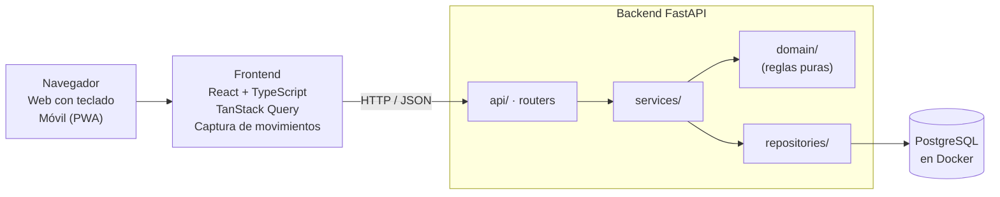

# Planeación: Digital Budget

Última actualización: 2026-11-05

> **Para Claude (u otra sesión que retome el proyecto):** este archivo es la fuente de verdad de la planeación. Antes de proponer cambios, lee el "Registro de decisiones" y respeta lo ya resuelto. Si el usuario toma una decisión nueva, agrégala al registro con su fecha y actualiza la sección afectada. El usuario trabaja solo, quiere experiencia full stack para su CV y prefiere conversar en español.

## Registro de decisiones

| Fecha | Decisión |
| --- | --- |
| 2026-11-04 | Stack: FastAPI + PostgreSQL + React/TypeScript. Todo local con Docker, preparado para deploy. |
| 2026-11-04 | Demo el 13 nov, v1 el 4 dic. Supuesto: ~6 h/día, 6 días/semana. |
| 2026-11-04 | La captura empieza convencional (fase 1). La barra de comandos y los gestos táctiles se detallan después de la v1 (fase 2). |
| 2026-11-04 | Se agrega el modo ahorro: monto real y contable, apartados, sobrante. |
| 2026-11-05 | Compras con tarjeta en modo ahorro: el real baja el crédito disponible de la tarjeta; el contable baja el disponible igual que con débito. Las cuentas de débito no cambian hasta pagar. |
| 2026-11-05 | La cuenta de ahorro "Sobrante" se crea por defecto y recibe las diferencias de redondeo. |
| 2026-11-05 | Cuentas de ahorro con meta: se deposita desde el disponible; al completar la meta aparece "Retirar ahorro", que cierra la cuenta y pasa el total al disponible. |
| 2026-11-05 | Nombre del proyecto: **Digital Budget**. Repositorio `digital-budget`. |
| 2026-11-05 | Advertencias en compras con tarjeta: nivel 1 si supera el disponible, nivel 2 si supera el saldo real. |
| 2026-11-05 | Frontend con React 19 (no 18), Tailwind v4, TypeScript 7 y Node 26 LTS. Se mantiene ESLint en lugar de oxlint, que trae la plantilla de Vite. |

## Resumen

Una webapp de finanzas personales que entiende cómo funcionan las tarjetas en México (corte, fecha límite de pago y meses sin intereses) y que, en modo ahorro, distingue tu saldo real de tu dinero disponible. Demo funcional el 13 de noviembre; v1 lista para usuarios externos el 4 de diciembre.

**Objetivos**

- Registrar un movimiento rápido y sin fricción; primero con captura convencional, después con barra de comandos y gestos.
- Saber en todo momento cuánto debo pagar de cada tarjeta y antes de qué fecha.
- Construir un proyecto de portafolio full stack, con pruebas, CI y listo para deploy.

**Supuestos de trabajo**

- Dedicación de ~6 horas al día, 6 días a la semana (unas 36 h/semana).
- Un solo desarrollador, presupuesto cero, todo corre en local con Docker.
- Moneda única: MXN. Sin conexión a bancos; los datos se capturan a mano.

**Alcance**

| | Demo (13 nov) | v1 (4 dic) |
| --- | --- | --- |
| Cuentas | Débito, efectivo, crédito y la cuenta Sobrante | + cuentas de ahorro con meta, archivar, reordenar, colores |
| Movimientos | Gasto, ingreso, transferencia, pago de tarjeta | + editar en lote, búsqueda, etiquetas |
| Tarjetas de crédito | Corte, fecha de pago, saldo del ciclo | + pago para no generar intereses, alertas en la app |
| MSI | Alta de compra y mensualidades por ciclo | + adelantar mensualidades, liquidar |
| Modo ahorro | Monto real y contable, apartados, sobrante, advertencias de compra | + redondeo automático, apartados recurrentes |
| Captura | Formulario convencional rápido, web y móvil | Igual, pulido; barra de comandos y gestos pasan a la fase 2 |
| Usuarios | Un usuario local | Registro, login y datos aislados por usuario |
| Calidad | Pruebas del dominio | + pruebas de API y E2E, CI en GitHub |

**Fuera de alcance por ahora:** sincronización bancaria, varias monedas, presupuestos por categoría, cobro de donaciones (solo un enlace), app nativa.

## Stack recomendado

FastAPI en el backend y React con TypeScript en el frontend: es la combinación con más vacantes para perfiles junior/mid full stack y deja ver tipado de punta a punta.

| Capa | Elección | Por qué suma al CV |
| --- | --- | --- |
| Backend | Python 3.12 + FastAPI + Pydantic v2 | API moderna, async, documentación OpenAPI automática |
| ORM y migraciones | SQLAlchemy 2.0 + Alembic | El estándar en Python; las migraciones se piden en casi cualquier puesto |
| Base de datos | PostgreSQL 16 | La base relacional más pedida; transacciones y `NUMERIC` para dinero |
| Frontend | React 19 + TypeScript + Vite | El framework con más demanda; TypeScript ya es requisito común |
| Estado del servidor | TanStack Query | Caché, reintentos y actualizaciones optimistas para que la captura se sienta instantánea |
| Estilos | Tailwind CSS | Rápido para iterar en web y móvil con un solo código |
| Cliente de API | Tipos generados desde OpenAPI (`openapi-typescript`) | Contrato tipado entre backend y frontend |
| PWA | `vite-plugin-pwa` | Instalable en el celular sin tienda de apps |
| Pruebas | pytest + httpx, Vitest, Playwright | Pruebas unitarias, de API y E2E: muy valorado en entrevistas |
| Infraestructura | Docker Compose, GitHub Actions | Todo local hoy; el mismo contenedor sirve para el deploy |
| Calidad | Ruff, mypy, ESLint, Prettier, pre-commit | Señal de profesionalismo en el repo |

**Alternativa considerada:** Next.js o NestJS con TypeScript en todo el stack. Tiene buena demanda, pero cambiarías Python por Node; con FastAPI ya muestras dos lenguajes, lo cual suele pesar más en un CV.

## Modelo de dominio y reglas de negocio

El corazón del proyecto es la tarjeta de crédito: un ciclo de corte, una fecha límite y compras a MSI que se reparten entre ciclos. Todo lo demás es un movimiento entre cuentas.

**Entidades**

| Entidad | Campos clave | Notas |
| --- | --- | --- |
| Cuenta | tipo (débito, efectivo, crédito, ahorro), nombre, saldo inicial, color | Una tabla con campos opcionales para crédito; ahorro: "Sobrante" por defecto y cuentas con meta (monto objetivo, estado) |
| Config. de crédito | límite, día de corte, día de pago | Uno a uno con la cuenta de crédito |
| Movimiento | cuenta, tipo, monto real, monto contable, fecha, descripción, categoría, apartado | Tipos: gasto, ingreso, transferencia, pago de tarjeta. Monto contable = real en modo simple |
| Transferencia | grupo que une dos movimientos | Sale de una cuenta y entra a otra en una sola transacción de BD |
| Apartado | nombre, monto, fecha esperada, recurrencia, estado | Gasto contemplado del modo ahorro; se consume al pagarlo |
| Plan MSI | cuenta, monto total, meses, fecha de compra | Genera una mensualidad por ciclo |
| Mensualidad MSI | plan, número, monto, ciclo asignado | Se calcula al crear el plan |
| Categoría | nombre, ícono | Precargadas; el usuario puede agregar |
| Preferencias | modo (simple o ahorro), múltiplo de redondeo | Una por usuario |

**Reglas**

1. El dinero se guarda como `NUMERIC(12,2)` en Postgres y `Decimal` en Python; nunca `float`.
2. Saldo de débito/efectivo = saldo inicial + ingresos − gastos ± transferencias.
3. Deuda de crédito = cargos − pagos. Crédito disponible = límite − deuda − mensualidades MSI aún no facturadas.
4. El ciclo de una tarjeta va del día siguiente al corte anterior hasta el día de corte, inclusive.
5. Si el día de corte o de pago no existe en el mes (por ejemplo 31 en noviembre), se usa el último día del mes.
6. Una compra a MSI ocupa el crédito completo de inmediato, pero solo su mensualidad entra en el pago de cada ciclo.
7. Mensualidad = total ÷ meses, redondeada a centavos; la última absorbe la diferencia para que la suma cuadre exacta.
8. Pago para no generar intereses = cargos normales del ciclo cerrado + mensualidades MSI de ese ciclo − pagos hechos después del corte.
9. Un pago de tarjeta es una transferencia de una cuenta de débito (o efectivo) a la cuenta de crédito.
10. Los movimientos nunca se borran físicamente: se marcan como eliminados para poder deshacer.

**Pendiente de confirmar con tus tarjetas reales:** si una compra hecha el día de corte entra en ese ciclo o en el siguiente, y si tu banco fija el pago por día del mes o por días después del corte. El modelo admite ambos con un campo de configuración.

## Modo ahorro

Un modo opcional que separa el dinero que tienes del dinero que de verdad puedes gastar. Con $5,000 en el banco y la luz de $500 ya contemplada, tu disponible es $4,500.

**Seis cifras en pantalla**

| Cifra | Qué es | En el ejemplo |
| --- | --- | --- |
| Saldo real | Lo que hay en tus cuentas de débito y efectivo | $5,000.00 |
| Apartado | Gastos contemplados que aún no pagas | $500.00 |
| Deuda de tarjetas | Lo que debes en tus tarjetas de crédito | $0.00 |
| Disponible | Lo que puedes gastar sin tocar lo apartado, lo ahorrado ni lo que debes | $4,500.00 |
| Sobrante | Saldo a favor que generan tus redondeos, en la cuenta "Sobrante" | $0.00 |
| Ahorros con meta | Lo depositado en tus cuentas de ahorro con objetivo | $0.00 |

Las seis siempre cuadran (invariante que se prueba en cada operación):

```
Saldo real = Disponible + Apartado + Deuda de tarjetas + Ahorros con meta + Sobrante
```

**Monto real y monto contable**

Cada movimiento guarda dos montos: el real, que es lo que se movió en el banco o la tarjeta, y el contable, que es lo que afecta tu disponible. La diferencia se acumula en el sobrante. En modo simple ambos son iguales.

| Paso | Real (MXN) | Contable (MXN) | Saldo real | Deuda | Disponible | Sobrante |
| --- | --- | --- | --- | --- | --- | --- |
| Inicio, luz apartada ($500) | — | — | 5,000.00 | 0.00 | 4,500.00 | 0.00 |
| Cine con débito | −387.56 | −400.00 | 4,612.44 | 0.00 | 4,100.00 | 12.44 |
| Despensa con tarjeta | −634.00 | −640.00 | 4,612.44 | 634.00 | 3,460.00 | 18.44 |
| Quincena | +10,164.67 | +10,000.00 | 14,777.11 | 634.00 | 13,460.00 | 183.11 |
| Pago de luz (costó 487.00) | −487.00 | −500.00 del apartado | 14,290.11 | 634.00 | 13,460.00 | 196.11 |
| Pago de tarjeta | −634.00 | — | 13,656.11 | 0.00 | 13,460.00 | 196.11 |

**Reglas**

1. En gastos el monto contable es mayor o igual al real; en ingresos, menor o igual. La app avisa si capturas lo contrario.
2. Al capturar, la app propone el monto contable redondeando al múltiplo que elijas (10 por defecto); lo puedes cambiar a mano.
3. Un apartado tiene nombre, monto y fecha esperada, y puede repetirse (luz cada dos meses). Pagarlo consume el apartado, no el disponible; la diferencia va al sobrante.
4. Una compra con tarjeta de crédito funciona igual que con débito para el disponible: baja por el monto contable. El monto real baja el crédito disponible de la tarjeta y sube su deuda; las cuentas de débito no cambian hasta que pagas.
5. Las compras a MSI siguen la misma regla con el monto total de la compra.
6. Pagar la tarjeta es una transferencia de débito a crédito: bajan el saldo real y la deuda por igual; el disponible y el sobrante no cambian.
7. La cuenta de ahorro "Sobrante" se crea de forma predeterminada y no se puede borrar. Ahí se acumula la diferencia entre montos reales y contables, y no cuenta en el disponible.
8. El modo se activa por usuario. Los datos guardan ambos montos desde el día 1, así que cambiar de modo no pierde información.

**Advertencias en compras con tarjeta de crédito**

El modo ahorro existe para no gastar dinero que no tienes. Por eso, al capturar una compra con tarjeta, la app compara antes de guardar y avisa, sin bloquear:

| Nivel | Cuándo | Qué ve el usuario |
| --- | --- | --- |
| 1 · Aviso | El monto contable supera el disponible | Mensaje en amarillo: "Esta compra supera tu disponible por $X" |
| 2 · Alerta | El monto real supera el saldo real de todas tus cuentas de débito y efectivo | Mensaje en rojo, más visible, y confirmar con un clic extra antes de guardar |

Si se cumplen ambas, solo se muestra el nivel 2. Aplica a cualquier compra con tarjeta, cerca o lejos de la quincena, incluidas las MSI.

**Cuentas de ahorro con meta**

Además de Sobrante, puedes crear cuentas de ahorro con un objetivo. Funcionan como un apartado que se llena con depósitos desde tu disponible.

| Paso | Disponible | Ahorro "Consola" | Falta | Saldo real |
| --- | --- | --- | --- | --- |
| Crear meta de $10,000 | 13,460.00 | 0.00 | 10,000.00 | 13,656.11 |
| Depositar $1,000 | 12,460.00 | 1,000.00 | 9,000.00 | 13,656.11 |
| Completar con depósitos | 3,460.00 | 10,000.00 | 0.00 | 13,656.11 |
| Retirar ahorro | 13,460.00 | cerrada | — | 13,656.11 |

1. Una meta tiene nombre, monto objetivo y lo ahorrado; la app muestra cuánto falta y el avance.
2. Depositar baja el disponible y sube la meta. El saldo real no cambia: el dinero sigue en tus cuentas.
3. Al llegar al objetivo aparece "Retirar ahorro": cierra la meta y pasa el total a tu disponible para hacer la compra.
4. Puedes tener varias metas a la vez. Sobrante no tiene meta y solo recibe las diferencias de redondeo.

**Por definir:** si se permite retirar una meta antes de completarla y si se puede depositar más del objetivo.

## Diseño de interacción

La captura llega en dos fases: primero una convencional que funcione bien en web y móvil, y después de la v1 la barra de comandos y los gestos, que se diseñarán a detalle en su momento.

**Fase 1 (demo y v1) · captura convencional**

- Un botón "Nuevo" (o la tecla `N`) abre un panel con tipo (pestañas), monto, cuenta y categoría. Fecha de hoy y última cuenta usada por defecto.
- `Enter` guarda y deja el panel listo para el siguiente movimiento; `Esc` cierra.
- En móvil el panel ocupa la pantalla y el campo de monto abre el teclado numérico del sistema.
- En modo ahorro aparece un segundo campo, monto contable, ya precargado con el redondeo propuesto.
- En compras con tarjeta se muestran las advertencias de nivel 1 o 2 antes de guardar.
- Pantalla inicial con saldo real, disponible, apartado, deuda de tarjetas y sobrante; y cuánto pagar de cada tarjeta.

**Fase 2 (después de la v1) · propuesta preliminar, se detallará más adelante**

*Web: barra de captura.* Una sola barra siempre visible arriba de la lista. Se enfoca con `/` o `N`. Mientras escribes, el texto se convierte en chips (monto, cuenta, categoría, fecha) para que veas cómo se interpretó. `Tab` autocompleta, `Enter` guarda, `Esc` limpia.

| Escribes | Se guarda como |
| --- | --- |
| `350 tacos @bbva #comida` | Gasto de $350 en BBVA, categoría Comida, hoy |
| `+15000 nómina @nu` | Ingreso de $15,000 en Nu |
| `2000 @bbva > @nu` | Transferencia de BBVA a Nu |
| `pago 5000 @bbva > @tdc-oro` | Pago de $5,000 a la tarjeta Oro desde BBVA |
| `12000 laptop @tdc-oro 12msi` | Compra a 12 MSI, mensualidades de $1,000 |
| `90 uber ayer` | Gasto de ayer en la última cuenta usada |

Otros atajos: `↑` `↓` para moverte en la lista, `E` editar, `Supr` eliminar con aviso de deshacer, `Ctrl+Z` deshacer, `1`–`9` para filtrar por cuenta y `?` para ver todos los atajos.

*Móvil: captura táctil.*

1. Un botón `+` grande abre un teclado numérico a pantalla completa: escribes el monto.
2. Debajo aparecen chips de cuenta (la última ya seleccionada) y las 6 categorías que más usas. Un toque elige.
3. Confirmas con un botón grande. Mantener presionado `+` cambia entre gasto, ingreso y transferencia.

En la lista: deslizar a la izquierda elimina (con deshacer), a la derecha duplica. Arriba, las cuentas son tarjetas que se deslizan horizontalmente.

**Principios**

- Un solo nivel de navegación: Movimientos, Cuentas, Tarjetas. Sin submenús.
- La configuración vive dentro de la cuenta que configura, no en una pantalla aparte.
- La UI se actualiza al instante (actualización optimista) y se sincroniza con la API en segundo plano.
- El intérprete de la barra (fase 2) será una función pura en TypeScript con pruebas propias; la API valida igual.

## Arquitectura

Un monorepo con dos aplicaciones y una base de datos, levantadas con `docker compose up`. Las reglas de negocio viven en una capa de dominio sin dependencias de FastAPI ni de la BD, para probarlas aisladas.



La API solo traduce HTTP; `services/` orquesta y abre transacciones; `domain/` calcula ciclos, MSI, saldos y modo ahorro sin tocar la base de datos.

**Estructura del repositorio**

```
digital-budget/
├── backend/
│   ├── app/
│   │   ├── domain/        # reglas: ciclos, MSI, saldos, modo ahorro (Python puro)
│   │   ├── models/        # SQLAlchemy
│   │   ├── schemas/       # Pydantic
│   │   ├── repositories/  # acceso a datos
│   │   ├── services/      # casos de uso, transacciones de BD
│   │   └── api/           # routers FastAPI
│   ├── alembic/
│   └── tests/
├── frontend/
│   ├── src/
│   │   ├── features/      # movements, accounts, cards
│   │   ├── capture/       # formulario de captura (barra en fase 2)
│   │   ├── api/           # cliente generado desde OpenAPI
│   │   └── ui/            # componentes compartidos
│   └── tests/
├── docker-compose.yml
├── CLAUDE.md
├── docs/PLANEACION.md
└── .github/workflows/ci.yml
```

**API principal (`/api/v1`)**

| Método y ruta | Uso |
| --- | --- |
| `GET/POST /accounts` | Listar y crear cuentas |
| `PATCH /accounts/{id}` | Editar cuenta y su configuración de crédito |
| `GET/POST /movements` | Listar con filtros y registrar gasto, ingreso o transferencia (monto real y contable); la respuesta de validación incluye advertencias de nivel 1 o 2 |
| `PATCH/DELETE /movements/{id}` | Editar o eliminar (borrado lógico) |
| `POST /installment-plans` | Crear compra a MSI y sus mensualidades |
| `GET /cards/{id}/statement?cycle=` | Resumen del ciclo: cargos, MSI, pagado, por pagar, fechas |
| `GET/POST/PATCH /commitments` | Apartados del modo ahorro |
| `GET /summary` | Saldo real, disponible, apartado, deuda, sobrante y próximos pagos |
| `POST /savings-goals`, `/{id}/deposit`, `/{id}/withdraw` | Crear metas de ahorro, depositar y retirar al completarlas |
| `GET/PATCH /preferences` | Modo simple o ahorro y múltiplo de redondeo |
| `POST /auth/register`, `/auth/login` | Usuarios (v1, semana 1) |

**Listo para deploy sin costo hoy:** configuración por variables de entorno, contenedores con imágenes de producción, migraciones automáticas al arrancar, CORS configurable y `user_id` en todas las tablas desde el día 1, aunque el demo tenga un solo usuario.

## Plan al demo (4–13 nov)

Ocho días de trabajo y un día de respiro. Primero el dominio con pruebas, luego la API, al final la interfaz: así la lógica de tarjetas queda sólida aunque la UI se recorte.

**Mié 4 · Base del proyecto**

- [x] Crear repo en GitHub con la estructura del monorepo
- [x] `docker-compose.yml` con Postgres, backend y frontend
- [x] FastAPI con `/health` y Vite + React + TS + Tailwind arrancando
- [ ] Ruff, mypy, ESLint, Prettier y pre-commit

**Jue 5 · Cuentas y movimientos**

- [ ] Modelos de cuenta, movimiento (con monto real y contable) y categoría + primera migración
- [ ] Cálculo de saldos en `domain/` con pruebas
- [ ] Transferencias como dos movimientos en una transacción

**Vie 6 · Ciclos de tarjeta de crédito**

- [ ] Cálculo del ciclo, fecha de corte y fecha de pago
- [ ] Pruebas de bordes: día 31, febrero, compra el día de corte, cambio de año
- [ ] Pago de tarjeta y deuda/crédito disponible

**Sáb 7 · MSI**

- [ ] Plan MSI y generación de mensualidades con redondeo exacto
- [ ] Endpoint de resumen del ciclo (`/cards/{id}/statement`)

**Dom 8 · Respiro o colchón** para lo que se haya atrasado.

**Lun 9 · API completa y primera pantalla**

- [ ] CRUD de cuentas y movimientos + `/summary`
- [ ] Generar cliente TypeScript desde OpenAPI
- [ ] Layout con lista de movimientos y tarjetas de cuenta

**Mar 10 · Modo ahorro en el dominio**

- [ ] Apartados, deuda de tarjetas y cuenta Sobrante en `domain/` con pruebas del invariante
- [ ] Regla de advertencias de nivel 1 y 2 con pruebas
- [ ] Probar con tus números reales: cine, despensa con tarjeta, quincena, luz
- [ ] Endpoints `/commitments`, `/preferences` y `/summary` con las seis cifras

**Mié 11 · Captura convencional**

- [ ] Panel de nuevo movimiento con valores por defecto y `Enter` para guardar
- [ ] Campo de monto contable con redondeo propuesto en modo ahorro
- [ ] Guardado optimista con TanStack Query y advertencias de nivel 1 y 2 en compras con tarjeta

**Jue 12 · Pantallas de saldos y tarjetas**

- [ ] Inicio con saldo real, disponible, apartado, deuda y sobrante
- [ ] Pantalla de tarjeta: por pagar, días para vencer, MSI activos
- [ ] Diseño responsivo y prueba en el celular por la red local

**Vie 13 · Demo**

- [ ] Datos semilla realistas (2 débito, 2 crédito, 1 MSI)
- [ ] README con capturas y cómo levantarlo
- [ ] Grabar un video corto del flujo completo

**Si algo se atrasa, se recorta en este orden:** apartados recurrentes, pantalla de tarjeta detallada. La lógica de ciclos, MSI, montos real/contable y advertencias no se recorta.

## Plan a la v1 (14 nov – 4 dic)

Tres semanas para pasar de demo personal a producto que otra persona pueda usar: usuarios, calidad y pulido. Cada semana cierra con algo que se puede mostrar.

**Semana 1 · 14–20 nov · Usuarios y seguridad**

- [ ] Registro y login con contraseñas en Argon2 y JWT en cookie httpOnly
- [ ] Aislar todos los datos por `user_id` con pruebas que lo verifiquen
- [ ] Pruebas de API con httpx para cada endpoint
- [ ] GitHub Actions: lint, tipos y pruebas en cada push

**Semana 2 · 21–27 nov · Experiencia de uso**

- [ ] Modo ahorro completo: redondeo automático configurable, apartados recurrentes, historial de la cuenta Sobrante, cuentas de ahorro con meta (depositar y retirar)
- [ ] Pruebas de punta a punta del modo ahorro con tarjetas y MSI
- [ ] PWA instalable con íconos y pantalla de inicio
- [ ] Editar movimientos, búsqueda, etiquetas; adelantar o liquidar MSI
- [ ] Usar la app tú mismo toda la semana en lugar del Excel y anotar fricciones

**Semana 3 · 28 nov – 4 dic · Calidad y lanzamiento**

- [ ] Pruebas E2E con Playwright del flujo de captura en web y móvil
- [ ] Corregir lo anotado en tu semana de uso
- [ ] Página de bienvenida con enlace de donación
- [ ] README de portafolio: arquitectura, decisiones, capturas, video
- [ ] Dejar documentado el paso a deploy en un servicio con plan gratuito

**Después del 4 dic · Fase 2 de captura:** diseñar a detalle la barra de comandos en web y los gestos táctiles en móvil, partiendo de la propuesta preliminar de este documento y de lo que aprendas usando la captura convencional.

## Riesgos, decisiones abiertas y valor para el CV

El mayor riesgo ahora es la interacción entre el modo ahorro y las tarjetas de crédito: es la regla de negocio más original del proyecto y la que más casos de borde tiene.

| Riesgo | Mitigación |
| --- | --- |
| Las reglas de ciclo no coinciden con tu banco | Validar con tus estados de cuenta reales el viernes 6 |
| El modo ahorro se descuadra | El invariante saldo real = disponible + apartado + deuda + ahorros + sobrante se prueba en cada operación |
| Tarjetas de crédito y MSI complican el modo ahorro | Regla ya definida; cubrir el invariante con pruebas que incluyan deuda de tarjetas y MSI |
| Curva de aprendizaje de React + TS | Empezar con componentes simples; nada de librerías de estado extra más allá de TanStack Query |
| Manejar datos financieros de terceros | Sin datos bancarios sensibles; aviso de privacidad y exportación/borrado de datos antes de abrir a otros |

**Decisiones abiertas**

- [ ] Regla de compras hechas el día de corte en tus bancos
- [ ] Retiro anticipado de metas de ahorro y depósitos por encima del objetivo
- [ ] Dominio para Digital Budget (y búsqueda de marca en MARCia antes de lanzar)
- [ ] Plataforma de donación (se decide en la semana 3)

**Lo que podrás contar en una entrevista**

- Modelaste reglas financieras reales (ciclos, MSI y un sistema de ahorro propio) con casos de borde y pruebas.
- Diseñaste una API tipada de punta a punta con OpenAPI.
- Construiste una UI rápida con actualización optimista y pensada para teclado y táctil.
- Tienes CI, contenedores y un camino claro a producción.
